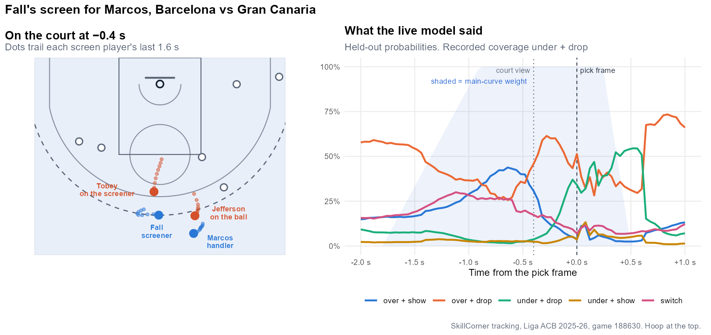

# Reading Pick-and-Roll Coverage Before the Screen

[](https://alex-susi.github.io/opendata-basketball/#/coverage-model)
[](https://www.r-project.org/)
[](https://github.com/SkillCorner/opendata-basketball)
[](LICENSE.md)


## 01 - Overview

This project asks whether a defense's pick-and-roll coverage can be read from player tracking **before** the screen is set. A transformer reads the last 1.6 s of movement by all ten players and gives a probability for each of five coverages every 0.04 s, from 2 s before the screen to 1 s after.

Every input is built from what has already happened, the model is never told when the screen lands, and each game is predicted by a model that never saw it. The intended user is a ball handler, scout or film room asking how a screen will be defended, and how early that is readable.

The **[Play Viewer](https://alex-susi.github.io/opendata-basketball/#/coverage-model)** shows the live read on every screen, with the full write-up on its Screen Coverage Model tab.

> SkillCorner open data, 10 Liga ACB 2025-26 games. Coverage labels are SkillCorner's (`bhrDefType`, `scrDefType`). Live model trained 2026-11-15.

<br>

## 02 - Key Findings

1. Movement history beats a position-only logistic baseline throughout. The gain is largest after the screen (0.121 lower log loss, better in all 10 games) and still clear before it (0.059, better in 8 of 10).

2. The screener's defender reads early. Before the screen the model names show, drop or switch correctly 58.5% of the time, against 51.5% for the defense's habit that night.

3. The ball handler's defender does not. "Expect over" is right 67.0% of the time, the model 67.4%.

4. Each defender's **level** (distance from the hoop minus the screener's) carries the read. Above the screen means over or show, below means under or drop.

5. Switches (21% recall) and under + show (19%) are mostly missed. A switch looks like over until the screen arrives.

<br>

## 03 - Methodology

1. **Screens and coverages**

   * 1,463 screens with all four screen players tracked from −2 s to +1 s.
   * Five coverages from the two defenders' labels. Over + show 34%, over + drop 33%, switch 15%, under + drop 11%, under + show 8%.
   * Ice (14 screens) and blitz (4) are too rare to learn and are left out.

2. **Inputs**

   * Every player at 9 moments, now back to 1.6 s ago. 16 measures each, including role, position relative to the screener and handler, level, level change, speed and turning.
   * Nine screen numbers. Time to act, the defense's earlier coverages that night, and handler-to-screener closeness.
   * No names, no ball, no screen timing, nothing after the prediction moment.

3. **Transformer**

   * Each player looks back over his own 1.6 s, then the ten players attend to each other.
   * The four screen players answer three yes/no questions. Switch? If not, under? Show? These give the five coverages.
   * About 35,700 weights, held in check by dropout, weight decay, early stopping and four averaged random starts.

4. **Baseline**

   * Multinomial logistic regression on 26 numbers about the same four players, also blind to screen timing.

5. **Grading**

   * Leave one game out. Eight games train, a ninth stops training, the tenth is predicted.
   * A fixed **main curve** weights each frame. Full weight from −0.9 s (the screen is obvious) to +0.24 s (the handler comes off the screener's shoulder), zero by −1.8 s and +0.5 s. These are the moments a read can still change a decision.

<br>

### Example Play

Jefferson climbs above the level before the screen, so over + drop leads (46% at −0.4 s). He slides under from the pick frame and under + drop takes over (50% at +0.4 s), the recorded coverage.



<br>

## 04 - Results

Held-out log loss on the 1,463 screens. Lower is better.

| Model | Main curve | Before screen | After screen | Ball handler's defender | Screener's defender |
| --- | --- | --- | --- | --- | --- |
| **Live transformer** | **1.114** | **1.277** | **0.779** | **0.696** | **0.790** |
| Logistic baseline | 1.192 | 1.336 | 0.900 | 0.735 | 0.838 |
| League mix of the other games | 1.460 | 1.460 | 1.460 | 0.864 | 1.013 |
| Even split (20% each) | 1.609 | 1.609 | 1.609 | – | – |

* **Main curve.** 0.078 better than the baseline, 95% interval 0.047 to 0.104 from resampling whole games.
* **Each defender.** 0.039 better for the ball handler's defender and 0.048 for the screener's.
* **Top coverage.** Correct on 55% of main-curve frames. Over + show and over + drop are caught about 70% of the time.

<br>

## 05 - Validation

* **Past-only test.** Scrambling everything after the prediction moment left all 180 sampled inputs and predictions unchanged. Scrambling the moment itself changed all 180.
* **Calibration.** Honest from about −0.5 s. Earlier, the leading coverage runs 5 to 8 points high.
* **Left out.** 33 of 1,496 screens lose a screen player's tracking and are not graded.

<br>

## 06 - Repo Structure

* `screen_coverage/01_scripts/` numbered pipeline, helpers in `R/`
* `screen_coverage/03_outputs/` results and figures
* `screen_coverage/04_docs/` full model write-up
* `play_viewer/` and `web/` the play viewer and static site
* `data/` and `docs/` SkillCorner's data and documentation, unchanged

<br>

## 07 - Running the Project

Requires R 4.4 and the SkillCorner data in `data/` as delivered by [SkillCorner/opendata-basketball](https://github.com/SkillCorner/opendata-basketball).

```r
install.packages(c("data.table", "jsonlite", "nnet", "shiny", "xgboost",
                   "ggplot2", "patchwork", "torch"))
torch::install_torch()
```

Build the caches and model inputs from the repository root.

```bash
Rscript play_viewer/01_app/build_cache.R
Rscript web/scripts/explore/build.R --bundles
Rscript screen_coverage/01_scripts/01_logistic_baseline.R
Rscript screen_coverage/01_scripts/02_build_sequences.R
```

Train one model per held-out game (about 25 minutes each on one CPU thread).

```r
for (g in jsonlite::fromJSON("data/matches.json")$id) {
  system2("Rscript", c("screen_coverage/01_scripts/03_train_transformer.R", paste0("--fold=", g)))
}
```

Score, test and draw.

```bash
Rscript screen_coverage/01_scripts/04_evaluate.R
Rscript screen_coverage/01_scripts/05_test_past_only.R
Rscript screen_coverage/01_scripts/14_weighted_scores.R
Rscript screen_coverage/01_scripts/22_confusion_matrices.R
Rscript screen_coverage/01_scripts/25_example_play.R
Rscript screen_coverage/01_scripts/27_readme_figure.R
```

<br>

## 08 - Limitations and Future Work

* **Small sample.** Ten games, about 1,170 training screens per fold.
* **Known screen.** The model is told who forms the screen. A live system must also detect it coming.
* **Vendor data.** Labels are SkillCorner's, and about 1 in 5 positions are off-camera estimates.
* **Rare coverages.** These likely depend on personnel the model never sees. Screens set by guards are switched twice as often (26% against 13%).
* **Drift.** The read slips back toward over after about +0.5 s.

<br>

## 09 - References

* SkillCorner Open Data, Liga ACB 2025-26 tracking and Game Intelligence events ([MIT](LICENSE)).
* Vaswani et al., *Attention Is All You Need* (2017).
